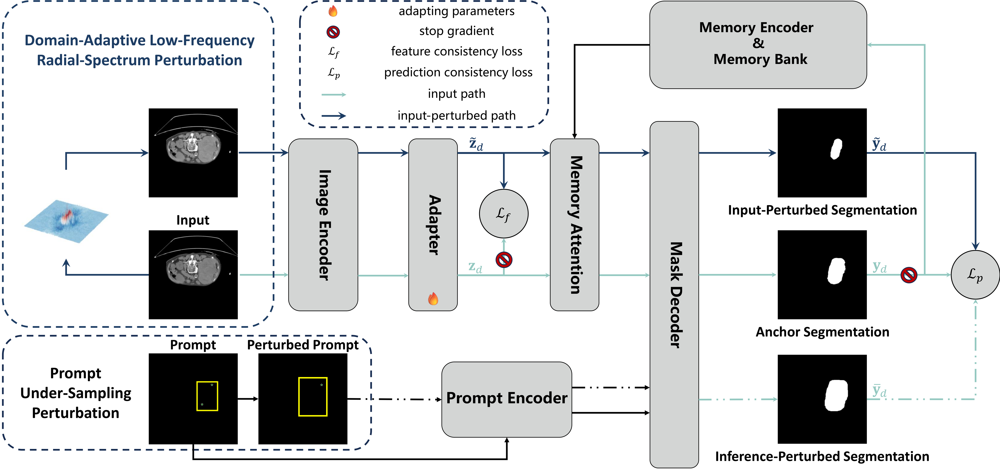

# SPDA: Efficient Online Test-Time Adaptation for Promptable Medical Segmentation

[[paper](https://link.springer.com/chapter/10.1007/978-3-032-37225-3_18)], [[suppl](https://media.springernature.com/original/springer-static/esm/chp%3A10.1007%2F978-3-032-37225-3_18/MediaObjects/700399_1_En_18_MOESM1_ESM.pdf)], [[poster](https://eccv.ecva.net/media/PosterPDFs/ECCV%202026/4824.png?t=1787931541.6979544)]

This repository is the official implementation of the **ECCV2026** paper "SPDA: Efficient Online Test-Time Adaptation for Promptable Medical Segmentation".

**Title**: SPDA: Efficient Online Test-Time Adaptation for Promptable Medical Segmentation \
**Authors**: Huixuan Xu, Hu Han, Shiguang Shan, Xilin Chen \
**Institute**: Institute of Computing Technology, Chinese Academy of Sciences; University of Chinese Academy of Sciences

<p align="center">
  
</p>

# Citing SPDA

```bibtex
@InProceedings{Xu_2026_SPDA,
    author    = {Xu, Huixuan and Han, Hu and Shan, Shiguang and Chen, Xilin},
    title     = {{SPDA}: Efficient Online Test-Time Adaptation for Promptable Medical Segmentation},
    booktitle = {Proceedings of the European Conference on Computer Vision (ECCV)},
    year      = {2026},
    pages     = {319--336},
}
```

# Abstract

Promptable foundation segmentation models exhibit impressive capabilities across diverse tasks, yet their performance deteriorates substantially on medical images due to domain and sub-domain shifts. Online test-time adaptation (OTTA) helps alleviate these shifts, but existing methods remain limited in effectiveness and efficiency. To this end, we introduce Semantic-Preserving Dual-Perturbation Adaptation (SPDA), a resource-efficient OTTA framework tailored for promptable medical segmentation. SPDA constructs diverse and robust learning signals by enforcing feature and prediction consistency across two semantic-preserving perturbations: (i) a domain-adaptive low-frequency radial-spectrum perturbation that simulates task-irrelevant intra-sub-domain variations without out-of-domain distortions, and (ii) a prompt under-sampling perturbation that reduces prompt density while preserving target semantics. These consistency constraints drive the optimization of a lightweight post-encoder adapter, facilitating efficient adaptation with minimal computational overhead. Extensive experiments on varied 2D/3D medical data demonstrate that SPDA consistently outperforms state-of-the-art OTTA baselines under box and point prompts, while using substantially fewer resources. Ablation studies validate each component and indicate the suitability for real-time clinical deployment.

# Requirements

The code requires Python 3.11 or later and the following packages, listed in `requirements.txt`:

```text
torch>=2.7.1,<2.8
numpy>=2.0.1,<2.3
scipy>=1.16.1,<1.17
pillow>=11.3.0,<12
matplotlib>=3.10.6,<3.11
scikit-image>=0.25.2,<0.26
opencv-python>=4.12.0.88,<4.13
hydra-core>=1.3.2,<1.4
omegaconf>=2.3.0,<2.4
iopath>=0.1.10,<0.2
tqdm>=4.67.1,<5
```

Choose one of the following installation methods and run the commands from the repository root. The examples use Python 3.11.

## conda

Create a conda environment, then install the dependencies with pip:

```bash
conda create -n spda python=3.11 pip -y
conda activate spda
python -m pip install -r requirements.txt
```

## pip

Using an existing Python 3.11 installation:

```bash
python3.11 -m venv .venv
source .venv/bin/activate
python -m pip install -r requirements.txt
```

## uv

```bash
uv venv --python 3.11
source .venv/bin/activate
uv pip install -r requirements.txt
```

# Datasets

We use 2D and 3D medical images from the **CVPR 2024: Segment Anything in Medical Images on Laptop** challenge, which covers 11 imaging modalities: CT, MRI, PET, ultrasound, X-ray, OCT, dermoscopy, endoscopy, fundus photography, mammography, and microscopy.

| Resource                     | Link                                                                    |
| ---------------------------- | ----------------------------------------------------------------------- |
| Challenge and dataset access | [Official Codabench page](https://www.codabench.org/competitions/1847/) |


# Reproduce the Results

Set the dataset, checkpoint, and output paths in `scripts/medsam2_spda_npz_2D_3D.sh`, then run it from the repository root:

```bash
bash scripts/medsam2_spda_npz_2D_3D.sh
```

For the baseline, set the same paths in `scripts/medsam2_eval_npz_2D_3D.sh`, using a separate output directory, then run:

```bash
bash scripts/medsam2_eval_npz_2D_3D.sh
```

# Reference

Our code builds on [SAM2](https://github.com/facebookresearch/sam2) and [MedSAM2](https://github.com/bowang-lab/MedSAM2). We thank the authors for making their code and models publicly available.

# Contact

If you have any other questions, please contact xuhuixuan24z@ict.ac.cn.
